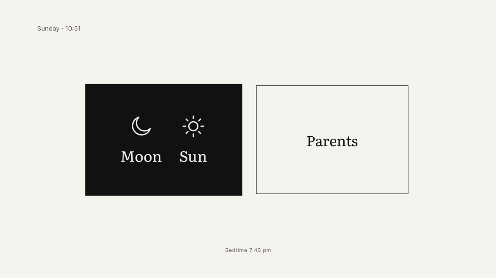
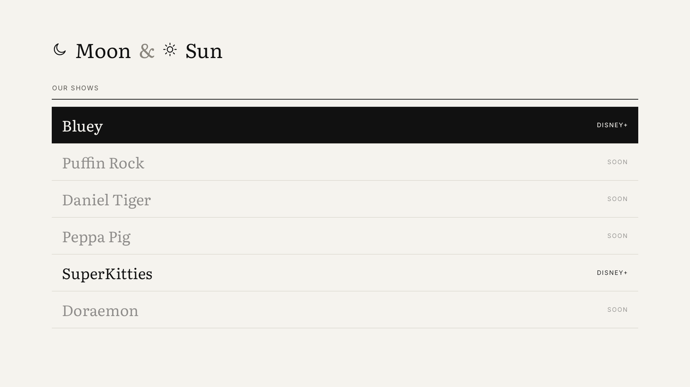
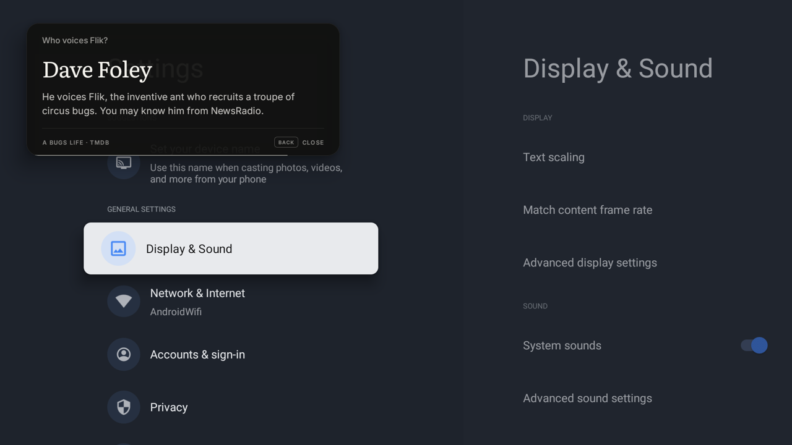
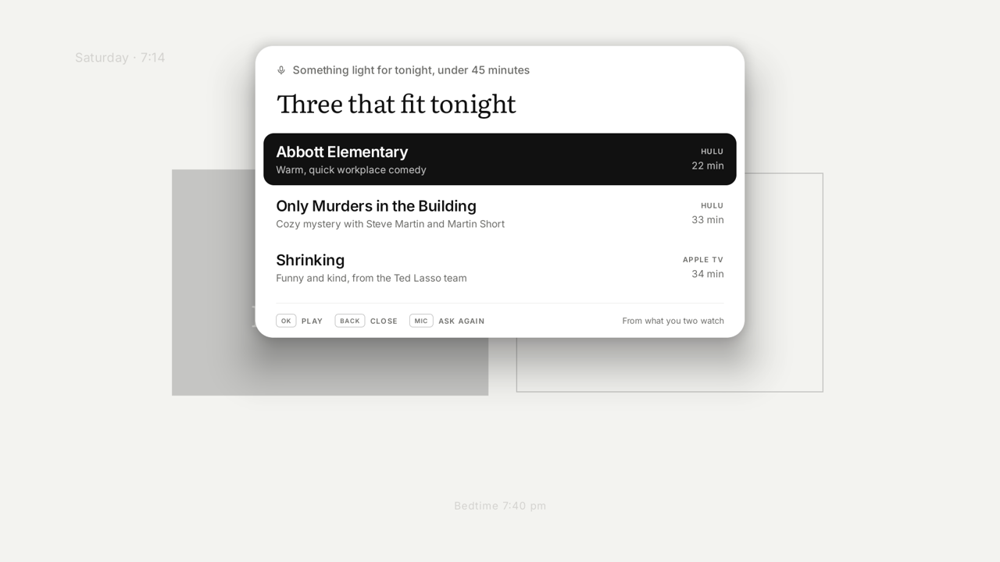

# Family TV

A calm, black-and-white home screen for an Android / Google TV, built for a family with young kids, with Claude
inside. Kids pick a show by name and it plays: no app home pages, no rows, no trailers. Parents get an Apple-style side
and can ask the TV anything with the mic on their phone remote.



| Kids' shows | Ask the TV over a show | Ask the TV on Home |
|---|---|---|
|  |  |  |

<sub>Screenshots from the Android TV emulator. The two Ask the TV screens show staged replies.</sub>

## What it does

- **Kids side: shows, not apps.** An allowlist of shows. Each one deep-links straight into the show behind a paper
  "OPENING · Bluey" cover. The launcher checks the screen before pressing Play and never presses OK blind. A guard pauses
  and comes home if a different show starts or playback ends.
- **Bedtime.** A small moon pill counts down in the corner, then "Goodnight", pause, and the TV turns off (without
  ever waking a TV that's already off).
- **Parents side.** Apps, Continue Watching, For You (TMDB + Claude), approving the kids' educational picks, the bedtime
  editor, devices and keys.
- **Ask the TV.** The phone remote's mic button opens our listener. Commands like "pause" or "turn the TV off in 30
  minutes" run instantly; questions go to Claude Haiku 5.5, and the answer shows in a small card at the top of the
  screen while the show keeps the rest. Questions that need today's facts are looked up with web search in the
  background. The kids side never reaches Claude.
- **Local API** (`:8765`) for an e-paper remote or voice: LAN-only, paired devices only, and pairing starts on the TV.
- **Privacy tools.** Find what the TV sends home and turn it off, reversibly (`scripts/privacy.sh`). On the Hisense
  we tested that included an ACR service fingerprinting the TV's audio.

Design notes, real-TV findings and the reasoning behind each choice: [`docs/NOTES.md`](docs/NOTES.md).

## Requirements

- An Android TV / Google TV on Android 11 or later (developed on a Hisense Google TV), or the Android TV emulator.
- Android SDK with platform-tools (adb), JDK 17.
- Optional: a [TMDB](https://www.themoviedb.org/settings/api) API key and an [Anthropic](https://console.anthropic.com)
  API key for recommendations and Ask the TV. Use a dedicated key with a monthly spend limit. Keys are typed on the TV,
  never put in code.

## Quick start

```bash
cd launcher && ./gradlew assembleDebug testDebugUnitTest      # build and run the unit tests
export ANDROID_SERIAL=<tv-ip>:5555                             # or emulator-5554; enable network debugging on the TV
adb connect $ANDROID_SERIAL

scripts/snapshot.sh            # record the TV's state first, so everything can be undone
adb install -r launcher/app/build/outputs/apk/debug/app-debug.apk
scripts/setup-tv.sh            # one-time grants: overlay, media sessions, screen reader, mic   (--undo to remove)
scripts/make-home.sh           # the launcher becomes Home                                    (restore.sh to undo)
scripts/mic-button.sh ask      # optional: the phone remote's mic opens Ask the TV            (google to undo)
scripts/restore.sh             # back to the TV exactly as it was
```

Then make it yours in [`Family.kt`](launcher/app/src/main/java/familytv/launcher/Family.kt) (names, streaming
profiles) and [`Catalog.kt`](launcher/app/src/main/java/familytv/launcher/Catalog.kt) (your kids' shows and their
deep links; see "Deep links" in the notes for the formats that work). Keys go in Parents → Keys on the TV.

Other scripts: `privacy.sh` (telemetry off, `--check`, `--undo`), `ask-tv-test.sh` (a runbook for testing the mic on a
real TV), `api-demo.sh` (pair a device with the local API), `disable.sh` (disables a package, refusing anything on
`protected-packages.txt`).

## Safety rules the code and scripts follow

- Nothing is uninstalled; apps are only disabled, and `restore.sh` undoes everything since the snapshot.
- The phone-remote service, Google Play services, keyboard, Bluetooth, network and the TV's core are protected.
- Never press OK/Play without confirming the right show. Netflix can't be confirmed, so Netflix launches are off by default.
- Check the TV isn't in use before any adb input. Test on the emulator first.
- API keys live encrypted on the TV only (Android Keystore). See [`SECURITY.md`](SECURITY.md).

## Code map

`launcher/app/src/main/java/familytv/launcher/`
- `ui/`: screens (Compose for TV)
- `playback/`: launch engine, kids guard, screen reader, media watcher
- `overlay/`: cover, bedtime pill, goodnight, pairing card
- `ask/`: Ask the TV (assist entry, speech, router, Claude, overlay card, sleep timer)
- `bedtime/`
- `api/`: local API
- `voice/`: EN/ES show resolver
- `recs/`: TMDB and Claude clients, recommendations
- `history/`: watch log
- `secrets/`: encrypted keys
- `remote/`: TV control (local adb), TV-remote protocol client

The controller protocol is in [`docs/controller-api.md`](docs/controller-api.md).

## License

MIT, see [`LICENSE`](LICENSE). Third-party notices: [`NOTICE.md`](NOTICE.md). Not affiliated with Google, Hisense, the
streaming services, Anthropic or TMDB.
